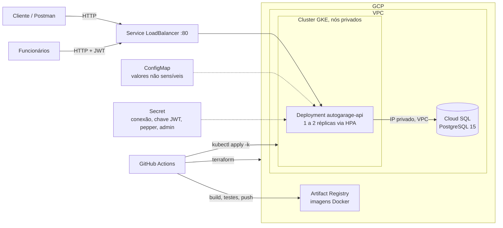

# oficina-mecanica-api

API para gestão de uma oficina mecânica: clientes, veículos, serviços, peças (materiais) e ordens de serviço, com controle de estoque e aprovação de orçamento pelo cliente.

Esta fase evolui a aplicação para uma arquitetura containerizada, implantada em Kubernetes (GKE), com infraestrutura provisionada por Terraform e entrega automatizada por GitHub Actions.

## Arquitetura de código

O código segue **Domain-Driven Design** com **Clean Architecture**: o domínio não depende de nenhum framework, as regras ficam nos casos de uso, e a infraestrutura implementa as interfaces definidas pelo domínio.

### Estrutura de pastas

```
src/
├── AutoGarage.Domain/                   # entidades, value objects, máquina de estados e interfaces de repositório
├── AutoGarage.Application/              # casos de uso, validadores e serviços de aplicação
├── AutoGarage.Infrastructure/           # EF Core (Npgsql), migrations FluentMigrator, geração de token JWT
├── AutoGarage.Api/                      # controllers, autenticação, tratamento de erros e Program.cs
└── Shared/AutoGarage.Communication/     # requests e responses HTTP
tests/                                   # testes unitários (Domain e Application) e de integração
```

### Dependências

`Domain` ← `Application` ← `Infrastructure`. A `Api` monta tudo na injeção de dependências. O `Domain` não importa nenhum pacote de framework.

### Padrões

- **Repository**: a interface fica no Domain, a implementação em Infrastructure.
- **Use case**: uma classe por caso de uso, com validação (FluentValidation) antes das regras de negócio.
- **Value objects e entidades** com regras de validação próprias.
- **Máquina de estados** para o ciclo de vida das ordens de serviço.
- **Erros de domínio** convertidos em respostas Problem Details.

### Componentes da aplicação

- **API (ASP.NET Core, .NET 10)**: autenticação JWT Bearer. Login, health check e acompanhamento público são anônimos; o restante exige token.
- **Application**: casos de uso e validadores, sem dependência de infraestrutura.
- **Domain**: entidades, máquina de estados das ordens de serviço, regras de orçamento e de estoque.
- **Infrastructure**: persistência, migrations e geração de token.

### Documentação de código

- [Arquitetura](docs/arquitetura/README.md): camadas, regras de dependência, padrões e fluxo de uma requisição.
- [Modelo de dados](docs/arquitetura/modelo-de-dados.md): tabelas, colunas e migrations.
- [Linguagem ubíqua](docs/arquitetura/linguagem-ubiqua.md): glossário do negócio e estados da ordem de serviço.
- [Princípios de código](docs/principios-de-codigo/Principios-de-Codigo.md): DDD, DRY, KISS, Clean Code e SOLID.
- [Value objects e entidades](docs/principios-de-codigo/ValueObjects-e-Entidades.md).
- [Tratamento de erros](docs/principios-de-codigo/ExceptionHandler-ProblemDetails.md).

## Arquitetura de infraestrutura



### Infraestrutura provisionada (Terraform, pasta `infra/`)

| Recurso | Função |
|---|---|
| VPC, sub-rede pública e privada, Cloud Router e Cloud NAT | Rede isolada, com saída para a internet pelos nós privados |
| Conexão de peering (Service Networking) | Acesso privado ao Cloud SQL |
| Cloud SQL (PostgreSQL 15, IP privado) | Banco de dados da aplicação |
| Artifact Registry (Docker) | Armazenamento das imagens |
| GKE (cluster com nós privados e node pool com autoescala) | Execução da aplicação |

O estado do Terraform fica em um bucket GCS. A documentação detalhada está em [docs/ci-cd/infra-workflow.md](docs/ci-cd/infra-workflow.md).

### Kubernetes (pasta `k8s/`)

- **Deployment** `autogarage-api-deployment`: porta 8080, probes de readiness e liveness em `/health`, execução sem root e com sistema de arquivos somente leitura.
- **Service** `autogarage-api-service` do tipo LoadBalancer, porta 80 para 8080.
- **HPA** `autogarage-api-hpa`: de 1 a 2 réplicas, escalando por CPU e memória (80%).
- **ConfigMap** `autogarage-api-config` com valores não sensíveis, e **Secret** `autogarage-api-secrets` com a conexão com o banco, a chave JWT, o pepper das senhas e as credenciais do primeiro administrador. Ambos são gerados pelo pipeline de release, e nenhum deles é commitado.

### Fluxo de deploy

1. **Infraestrutura** (`infra.yml`, manual): `terraform apply` cria os recursos da tabela acima.
2. **CI** (`ci.yml`, em push para `main` e em pull requests): formatação, build, testes e análise do SonarCloud.
3. **Release** (`release.yml`, ao criar uma tag `v*`): verifica se a imagem já existe, faz build e testes, publica a imagem no Artifact Registry, gera o ConfigMap e o Secret a partir dos secrets do GitHub e aplica os manifestos no GKE. O job de deploy exige aprovação no ambiente `production`.

Detalhes em [docs/ci-cd](docs/ci-cd/README.md).

Documentação detalhada: [Terraform](docs/infraestrutura/terraform.md), com os recursos, o motivo de cada um e como aplicar manualmente; e [Kubernetes](docs/infraestrutura/kubernetes.md), com a separação entre base e overlay, a configuração e como aplicar.

## Execução local

O `docker-compose.yml` sobe um ambiente de testes efêmero, com PostgreSQL e a API:

```bash
docker compose up --build -d
curl http://localhost:7169/health
```

A API fica em `http://localhost:7169`. Os dados ficam em `tmpfs` e somem com `docker compose down`. O ambiente já vem com clientes, veículos, ordens de serviço e funcionários de teste.

## Testes

Os testes automatizados rodam com:

```bash
dotnet test src/AutoGarage.slnx
```

Para testar a API manualmente, com a collection do Postman, os logins de teste e os exemplos de chamadas, siga [docs/como-testar/README.md](docs/como-testar/README.md).
