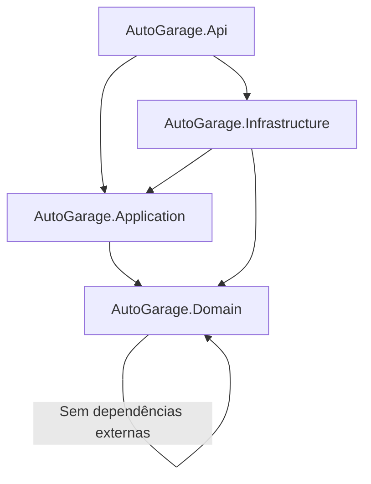

# Arquitetura - AutoGarage

## Visão Geral

O AutoGarage segue os princípios de **Domain-Driven Design (DDD)** aliado à **Clean Architecture**, organizando o código em camadas com clara separação de responsabilidades e inversão de dependências.

## Estrutura de Projetos

A solução é dividida em 4 projetos, seguindo a direção de dependência da Clean Architecture:

```
AutoGarage.slnx
├── src/
│   ├── AutoGarage.Domain          # Núcleo do domínio - Regras de negócio puras
│   ├── AutoGarage.Application     # Casos de uso e portas - Orquestração
│   ├── AutoGarage.Infrastructure  # Implementações - Persistência, segurança, etc.
│   └── AutoGarage.Api             # Apresentação - Controllers, Middlewares, Program.cs
└── tests/
    └── AutoGarage.UnitTests
```

## Direção de Dependências



**Regras imutáveis:**
1. `Domain` não importa nada. É puro, sem dependências de frameworks.
2. `Application` importa apenas `Domain`. Define contratos (interfaces/portas) e orquestra regras.
3. `Infrastructure` implementa interfaces definidas em `Application` e pode importar `Domain` e `Application`.
4. `Api` é o entry point, importa `Application` e `Infrastructure` (para configuração de DI), mas nunca contém regras de negócio.

## Responsabilidades por Projeto

### AutoGarage.Domain
**Propósito:** Coração da aplicação. Contém entidades, value objects, agregados, enums e exceções de domínio.

**O que vai aqui:**
- **Entidades/Aggregados**: Objetos com identidade e ciclo de vida (ex: `Customer`, `Vehicle`, `ServiceOrder`)
- **Value Objects (VO)**: Objetos imutáveis definidos por valor (ex: `Document`, `Plate`, `Money`)
- **Enums de Domínio**: `ServiceOrderStatus`, `EntityStatus`, `TransactionType`, `AuthorType`
- **Exceções de Domínio**: Regras violadas que pertencem ao negócio
- **Eventos de Domínio** (quando aplicável)
- **Interfaces/Abstrações puras** quando necessárias ao domínio

**Regras:**
- Sem referências a Entity Framework, ASP.NET Core ou qualquer framework
- Sem anotações de persistência
- Lógica pura e testável
- Métodos expressam comportamento, não apenas getters/setters

### AutoGarage.Application
**Propósito:** Orquestração dos casos de uso. Define o que a aplicação faz, independente de como é feito.

**O que vai aqui:**
- **Use Cases/Services**: Casos de uso da aplicação (ex: `CreateCustomerUseCase`, `OpenServiceOrderUseCase`)
- **Commands/Queries**: DTOs para entrada dos casos de uso (geralmente records)
- **Ports (Interfaces)**: Contratos para dependências externas (ex: `ICustomerRepository`, `IUnitOfWork`)
- **Validators**: Validações com FluentValidation
- **Mappers/Contracts**: Interfaces para mapeamento quando necessário
- **DTOs**: Objetos de transferência específicos da aplicação

**Regras:**
- Depende apenas do `Domain`
- Não conhece detalhes de HTTP, banco de dados ou infraestrutura
- Define portas, não implementações
- Toda regra de orquestração fica aqui

### AutoGarage.Infrastructure
**Propósito:** Implementações concretas das portas definidas em `Application`. Adaptadores para tecnologias externas.

**O que vai aqui:**
- **Persistence**: DbContext do Entity Framework Core, configurações, migrations, repositórios
- **Repositories Implementations**: Implementação das interfaces do `Application`
- **External Services**: Integrações com serviços externos
- **Authentication/Authorization**: Implementação JWT, geração/validação de tokens
- **Security**: Hash de senhas (BCrypt.Net-Next)
- **Dependency Injection**: Configurações de DI da camada

**Regras:**
- Implementa interfaces do `Application`
- Pode usar Entity Framework Core, Npgsql, BCrypt, etc.
- Não expõe detalhes de infraestrutura para camadas superiores
- Conversão entre entidades de domínio e entidades de persistência

### AutoGarage.Api
**Propósito:** Camada de apresentação. Ponto de entrada da aplicação REST.

**O que vai aqui:**
- **Controllers**: Endpoints REST
- **DTOs Request/Response**: Contratos HTTP
- **Middlewares**: Tratamento de erros, autenticação, etc.
- **Filters/Attributes**: Filtros customizados
- **Configuration**: Program.cs, appsettings, extensão de DI
- **Swagger/OpenAPI**: Configuração da documentação
- **Health Checks**: Configuração de health checks

**Regras:**
- Apenas delega para casos de uso da camada `Application`
- Não contém regras de negócio
- Trata apenas questões HTTP (status codes, validação de requisição)
- Usa `FluentValidation` para validação de entrada
- Usa `Mapster` para mapeamento DTO <-> Command/Query

## Padrões Adotados

| Padrão | Aplicação |
|---|---|
| **Repository** | Interface em `Application` (porta), implementação em `Infrastructure` (adaptador) |
| **Use Case** | Cada caso de uso tem sua própria classe/orquestração em `Application` |
| **Value Object** | Objetos imutáveis com validação própria no `Domain` |
| **Aggregate Root** | Entidade principal que controla o acesso a objetos internos |
| **DTO** | Usar `record` para imutabilidade em C# |
| **Dependency Injection** | Nativo do ASP.NET Core, configurado em cada projeto quando necessário |

## Fluxo de uma Requisição

```
1. Cliente HTTP → Api/Controller
2. Controller valida entrada (FluentValidation) e mapeia para Command (Mapster)
3. Controller chama Use Case em Application
4. Use Case aplica regras de negócio usando entidades do Domain
5. Use Case chama Repository (interface) para persistir/buscar
6. Infrastructure implementa Repository usando EF Core
7. Resposta volta: Domain → Application → Api → mapeada para Response DTO → Cliente
```

## Tecnologias Principais

| Camada | Tecnologias |
|---|---|
| **Api** | ASP.NET Core 10, Swashbuckle, FluentValidation.AspNetCore, Microsoft.AspNetCore.Authentication.JwtBearer |
| **Application** | FluentValidation, Mapster |
| **Infrastructure** | Entity Framework Core 10, Npgsql.EntityFrameworkCore.PostgreSQL, BCrypt.Net-Next, Microsoft.EntityFrameworkCore.Design |
| **Domain** | Puro C# (sem dependências externas) |
| **Testes** | xUnit, Moq, Testcontainers.PostgreSql, coverlet.collector |
