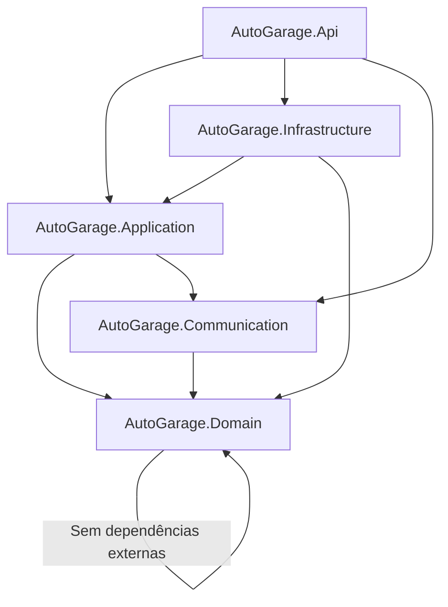

# Arquitetura - AutoGarage

## Visão Geral

O AutoGarage segue os princípios de **Domain-Driven Design (DDD)** aliado à **Clean Architecture**, organizando o código em camadas com clara separação de responsabilidades e inversão de dependências.

## Estrutura de Projetos

A solução é composta pelos projetos abaixo, seguindo a direção de dependência da Clean Architecture:

```
src/AutoGarage.slnx
├── src/
│   ├── AutoGarage.Domain          # Núcleo do domínio - Regras de negócio puras
│   ├── AutoGarage.Application     # Casos de uso e validações - Orquestração
│   ├── AutoGarage.Infrastructure  # Implementações - Persistência, migrations, DI
│   ├── AutoGarage.Api             # Apresentação - Controllers, ExceptionHandler, Program.cs
│   └── Shared/AutoGarage.Communication  # Contratos HTTP (Requests/Responses) compartilhados
└── tests/
    ├── AutoGarage.CommonTestUtilities      # Builders, fakes e helpers para os testes
    ├── AutoGarage.Domain.UnitTests         # Testes unitários do Domain
    ├── AutoGarage.Application.UnitTests    # Testes unitários dos casos de uso (Application)
    └── AutoGarage.IntegrationTests         # Testes de integração do repositório (EF Core InMemory)
```

Todos os projetos de teste ficam na pasta `/tests/` da solução. Os testes não dependem de banco externo nem de Docker.

## Direção de Dependências



**Regras:**
1. `Domain` não importa nada. É puro, sem dependências de frameworks.
2. `Application` importa `Domain` e `Communication`. Orquestra os casos de uso e valida as entradas.
3. `Infrastructure` implementa as interfaces de repositório definidas em `Domain` e pode importar `Domain` e `Application`.
4. `Api` é o entry point, importa `Application` e `Infrastructure` (para configuração de DI), mas nunca contém regras de negócio.

## Responsabilidades por Projeto

### AutoGarage.Domain
**Propósito:** Coração da aplicação. Contém entidades, value objects, enums, exceções de domínio e as interfaces de repositório.

**O que vai aqui:**
- **Entidades/Aggregados**: Objetos com identidade e ciclo de vida (ex: `Employee`)
- **Value Objects (VO)**: Objetos imutáveis definidos por valor (ex: `Document`, `Plate`)
- **Enums de Domínio**: `EmployeeRole` (`MECHANIC`, `ATTENDANT`), `EntityStatus` (`ACTIVE`, `INACTIVE`)
- **Exceções de Domínio**: Regras violadas que pertencem ao negócio, com bases de categoria HTTP (`NotFoundDomainException`, `ConflictDomainException`, `BadRequestDomainException`)
- **Interfaces de repositório**: `IEmployeeReadOnlyRepository`, `IEmployeeWriteOnlyRepository`, `IUnitWork`

**Regras:**
- Sem referências a Entity Framework, ASP.NET Core ou qualquer framework
- Sem anotações de persistência
- Lógica pura e testável
- Métodos expressam comportamento, não apenas getters/setters
- Invariantes de estado e transição (ex: não ativar quem já está ativo) ficam na entidade. Validações de entrada (campos obrigatórios, formato) ficam na Application.

### AutoGarage.Application
**Propósito:** Orquestração dos casos de uso. Define o que a aplicação faz, independente de como é feito.

**O que vai aqui:**
- **Use Cases**: Casos de uso (ex: `CreateEmployeeUseCase`), com interface própria (`ICreateEmployeeUseCase`)
- **Commands**: Entradas dos casos de uso, como `record` (ex: `CreateEmployeeCommand`)
- **Validators**: Validações com FluentValidation, executadas dentro do caso de uso
- **Normalização**: Limpeza de entradas (espaços, caixa) antes da validação
- **Serviços**: Ex: `PasswordEncripter`, `EmployeeMappingConfig` (Mapster)

**Regras:**
- Depende do `Domain` e dos contratos em `Shared/AutoGarage.Communication`
- Não conhece detalhes de HTTP, banco de dados ou infraestrutura
- Toda regra de orquestração e toda validação de entrada ficam aqui

### AutoGarage.Infrastructure
**Propósito:** Implementações concretas das interfaces de repositório definidas no `Domain`. Adaptadores para tecnologias externas.

**O que vai aqui:**
- **Persistence**: `AppDbContext` do Entity Framework Core, configurações de entidade e repositórios
- **Migrations**: Migrations versionadas com FluentMigrator (`Migrations/Versions/`)
- **Dependency Injection**: `AddInfrastructure`, chamado no `Program.cs` da Api

**Regras:**
- Implementa as interfaces de repositório do `Domain`
- Não expõe detalhes de infraestrutura para camadas superiores
- Conversão entre entidades de domínio e modelos de persistência, quando necessário

### AutoGarage.Api
**Propósito:** Camada de apresentação. Ponto de entrada da aplicação REST.

**O que vai aqui:**
- **Controllers**: Endpoints REST (`Controllers/Employees/EmployeesController.cs`)
- **Exceptions**: `ExceptionHandler` global, que converte erros em Problem Details
- **Configuration**: `Program.cs`, `appsettings.json`, serialização JSON (enums como texto)
- **Swagger/OpenAPI**: Configuração da documentação
- **Health Checks**: Endpoint `/health`

**Regras:**
- Apenas delega para casos de uso da camada `Application`
- Não contém regras de negócio nem validação de entrada (ela fica no caso de uso)
- Trata apenas questões HTTP (mapeamento de Request para Command, status codes e Problem Details)

### AutoGarage.Communication (Shared)
**Propósito:** Contratos HTTP de entrada e saída, usados pela Api e pela Application.

- **Requests**: ex: `CreateEmployeeRequest`
- **Responses**: ex: `EmployeeResponse`, `ErrorResponse` (Problem Details)

## Padrões Adotados

| Padrão | Aplicação |
|---|---|
| **Repository** | Interface no `Domain` (`Repositories/`), implementação em `Infrastructure` (adaptador) |
| **Use Case** | Cada caso de uso tem sua própria classe e interface em `Application/UseCases/` |
| **Value Object** | Objetos imutáveis com validação própria no `Domain` |
| **Aggregate Root** | Entidade principal que controla o acesso a objetos internos |
| **DTO** | Usar `record` para imutabilidade em C# |
| **Dependency Injection** | Nativo do ASP.NET Core, com um `DependencyInjection.cs` por camada |

## Fluxo de uma Requisição

```
1. Cliente HTTP → Api/Controller
2. Controller mapeia o Request para Command (Mapster)
3. Controller chama o Use Case em Application
4. Use Case normaliza a entrada, valida (FluentValidation) e aplica regras de negócio usando entidades do Domain
5. Use Case chama o Repository (interface do Domain) para persistir/buscar
6. Infrastructure implementa o Repository usando EF Core
7. Resposta volta: Domain → Application → Api → mapeada para Response → Cliente
8. Erros de domínio e de validação são convertidos em Problem Details pelo ExceptionHandler
```

## Tecnologias Principais

Esta tabela lista o que está em uso. Pacotes referenciados mas ainda sem uso estão marcados.

| Camada | Tecnologias |
|---|---|
| **Api** | ASP.NET Core 10, Microsoft.AspNetCore.OpenApi, Health Checks. Referenciados, sem uso ainda: Swashbuckle.AspNetCore, Microsoft.AspNetCore.Authentication.JwtBearer |
| **Application** | FluentValidation, Mapster |
| **Infrastructure** | Entity Framework Core 10, Npgsql.EntityFrameworkCore.PostgreSQL, FluentMigrator, Dapper (criação do banco na inicialização). Referenciado, sem uso ainda: Microsoft.AspNetCore.Identity |
| **Domain** | Puro C# (sem dependências externas) |
| **Testes** | xUnit 2.9.3, Shouldly, Bogus (dados de teste), Microsoft.EntityFrameworkCore.InMemory (integração sem banco externo), coverlet.collector |

## Decisões de arquitetura

Registro das divergências entre a regra desejada e o código, com a decisão tomada. Os itens marcados como **Pendente** ainda não foram decididos.

| # | Tema | Decisão | Situação |
|---|---|---|---|
| 1 | `Application` referencia `Communication` (contratos HTTP) | Aceito. `Communication` é a camada compartilhada de contratos. | Decidido |
| 2 | Interfaces de repositório em `Domain` (e não em `Application`) | Mantidas no `Domain`, junto ao modelo. | Decidido |
| 3 | Validação de entrada dentro do Use Case (e não no Controller) | Mantida no Use Case, por ser regra de aplicação. | Decidido |
| 4 | Hash de senha: SHA-512 com chave fixa (`PasswordEncripter`), e não bcrypt como exige a spec | Migrar para bcrypt. Exige recriar os hashes já gravados. | **Pendente** |
| 5 | Validação de nome e e-mail fora do `Domain` (`Employee.Create` valida só o role) | Mantida na Application. A entidade valida apenas invariantes de estado. | Decidido |
| 6 | `ExceptionHandler` não registra em log os erros inesperados | Adicionar `ILogger` no handler. | **Pendente** |
| 7 | `ErrorOnValidationException` em `Domain/Common/Exceptions/` | Mantida no `Domain`, por legibilidade e entendimento do código. | Decidido |
| 8 | Banco usado pelos testes de integração do repositório | Testes de integração rodam com EF Core InMemory, sem banco externo nem Docker. Consequência: a ordenação de `uuid` do PostgreSQL e a unicidade do índice de e-mail não são cobertas por teste automatizado. | Decidido |

## Documentos relacionados

- [Modelo de dados](modelo-de-dados.md): schema, migrations e regras de tradução para o código.
