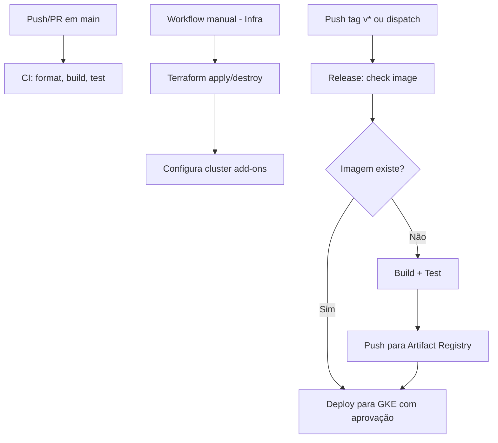

# CI/CD - Visão Geral

Este projeto utiliza **GitHub Actions** para automatizar validação, build, publicação de imagem e deploy em **Google Kubernetes Engine (GKE)**. Os workflows estão organizados em `.github/workflows/` com responsabilidades bem definidas.

## Workflows Atuais

| Workflow | Arquivo | Trigger | Função |
|---|---|---|---|
| **CI** | `ci.yml` | `push` para `main` e `pull_request` | Análise estática, restore, format-check, build e testes. |
| **Infrastructure** | `infra.yml` | `workflow_dispatch` (manual) | Provisão/destruição da infraestrutura via **Terraform** e configuração dos add-ons do cluster (kubeconfig + External Secrets Operator). |
| **Release** | `release.yml` | `push` de tag `v*` ou `workflow_dispatch` com `tag` | Validação, build/push da imagem no **Artifact Registry**, deploy no **GKE** com aprovação manual via environment `production`. |

## Fluxo Geral

## Ambientes e Segredos

Os workflows utilizam **GitHub Environments** e **Secrets/Vars**:

| Recurso | Uso |
|---|---|
| **Environment `production`** | Gating manual no job `deploy` do `release.yml` (requer aprovação de reviewers). |
| **Secrets (WIF)** | `GCP_WORKLOAD_IDENTITY_PROVIDER`, `GCP_SERVICE_ACCOUNT`, `GCP_PROJECT_ID`, `DB_PASSWORD`, `RUNTIME_CONFIG` |
| **Vars** | `GCP_REGION` |

> Autenticação via **Workload Identity Federation (WIF)** (sem chaves JSON).

## Documentação Detalhada

- [CI Workflow](./ci-workflow.md) - Validação contínua em PRs e pushes
- [Infrastructure Workflow](./infra-workflow.md) - Provisionamento Terraform e configuração de cluster
- [Release Workflow](./release-workflow.md) - Build, publicação e deploy com versionamento por tag
